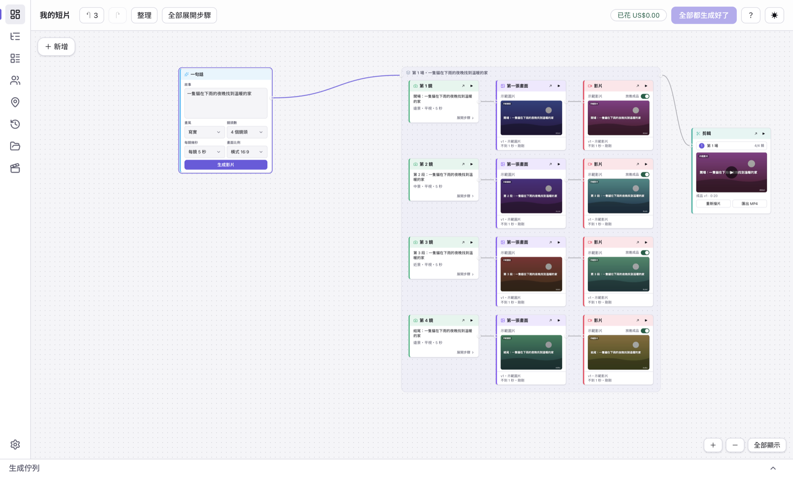
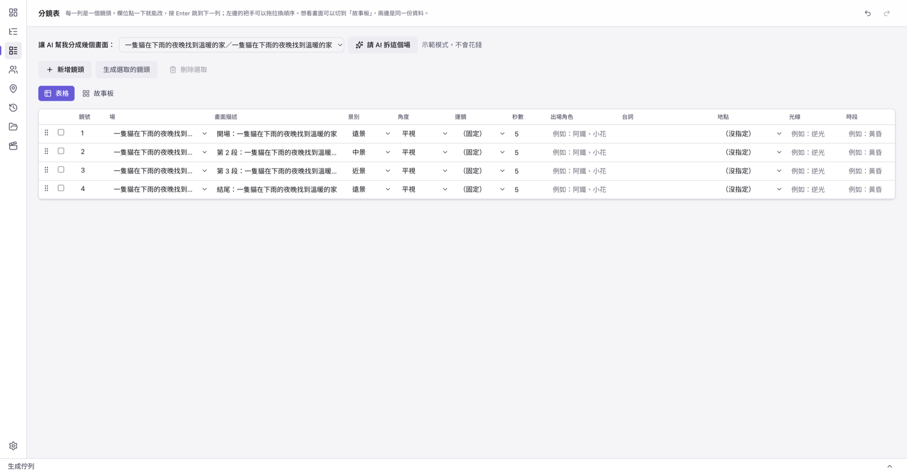

# Slima Video Studio

**English** · [繁體中文](README.zh-TW.md)

A free, open-source desktop studio that turns a story into an AI video. You write a sentence or paste a script; the app breaks it into scenes and shots, generates a first frame and a clip for every shot, and joins them into one finished film. Everything lives on an editable node canvas, so you can fix any single shot and re-run just that part.

It is **bring-your-own-key**: the app has no server and provides no models. You connect your own AI service account (one [OpenRouter](https://openrouter.ai) key is enough for text, images and video), and you see the estimated cost before anything is generated.

> **Status: early (v0.x).** It works end to end on macOS (Apple Silicon). A Windows build exists but has not been tested on a real Windows machine and is not offered for download yet. The installers are not code-signed yet (see [First launch](#first-launch)). The user interface is currently in Traditional Chinese only.



_Demo mode: the pictures are placeholders, so you can see the whole flow without a key or any cost._

## What you can do

- **Story to film on one canvas.** Write one sentence, pick a style, the number of shots and seconds per shot, and the canvas grows a whole short film: scenes, shots, first frames, video clips and a cut.
- **Fix one shot, not the whole film.** Edit a shot's description or its characters and only the affected pictures and clips are marked "needs re-run". Every shot keeps its versions.
- **Characters and locations.** Character cards with a locked appearance description, concept images and three-view turnarounds, so the same character can be reused across shots.
- **See the cost first.** Every run shows an estimate and asks for confirmation; a per-run limit (default US$5) protects you from surprises.
- **Preview and export.** Play the joined film in the app and export it as an MP4. Joining uses the bundled FFmpeg; nothing leaves your computer except the calls to the AI service you configured.
- **Tables as well as a canvas.** Outline, storyboard table, characters, locations, generation history and files are all views of the same data; undo and redo work across them.
- **Optional:** import a story from [Slima](https://slima.ai) (read-only, through the official `slima-mcp`).



## Get started

### Download

Installers are published on the repository's **Releases** page: a `.dmg` for macOS (Apple Silicon). The Windows installer follows once its bundled FFmpeg is built from source (see below). Each release lists a SHA-256 checksum for every file.

### First launch

The installers are not signed with an Apple Developer ID or a Windows code-signing certificate yet, so your system will warn you the first time:

- **macOS:** open **System Settings → Privacy & Security**, scroll down to the message about "Slima Video Studio" being blocked, click **Open Anyway** and enter your password. If macOS says the app is "damaged", run `xattr -dr com.apple.quarantine "/Applications/Slima Video Studio.app"` in Terminal and open it again.
- **Windows:** in the SmartScreen window click **More info → Run anyway**.
- There is **no automatic update** yet; download the new version from Releases.

### Try it without a key

On first launch choose **"先試玩看看" (Try it out)**. The app then uses fake providers: you can walk through the whole flow for free, no key and no network.


### Use real AI

1. Create an [OpenRouter](https://openrouter.ai) account, add a few dollars of credit, and create an API key (set a spending limit on the key if you like). The account needs credit for the paid image and video models.
2. In the app's setup wizard (or Settings) paste the key. It is stored encrypted on your computer by the operating system and is never shown again in full.
3. On the canvas, write a sentence, set the shots and seconds, press **Generate** and check the estimate.

A short test film of 2 shots × 3 seconds cost about US$1.1 in our own run. Estimates can be lower than the real price (our run was estimated at US$0.78), so start small.

## Connect Claude (let an AI drive the app)

Besides clicking, you can let an AI assistant such as **Claude Code** or **Claude Desktop** make the film for you. The app contains a small local server that speaks [MCP](https://modelcontextprotocol.io): the assistant can create a project, split your story into scenes and shots, generate and look at first frames, generate videos, re-do a shot, join the shots and export the MP4, all in the same project you see on screen. Nothing is installed besides the app, and the connection never leaves your computer (`127.0.0.1` only).


_The real settings page of the app (the token is hidden until you press "顯示 token")._

**Connect in one click** (needs v0.2.0 or later; the app must be open):

1. Open the app → **Settings (設定) → AI 工具連線 (MCP)**.
2. Press **連接 Claude Code** or **連接 Claude Desktop**. This also switches on "允許 AI 工具連線". For Claude Desktop, quit it completely (⌘Q) and open it again; the app backs up Claude Desktop's configuration file before adding one entry and leaves your other servers untouched.
3. Tell your assistant, for example: _"Use the slima-video-studio tools. Call get_capabilities, then load the getting-started guide, and make a 3-shot film from this story: …"_

In **Claude Code**, type `/mcp` to check that `slima-video-studio` is connected. If you prefer to paste a command yourself, Settings also shows the manual `claude mcp add …` line.

**What protects you**

- **Off by default**, only on `127.0.0.1`, and every request needs a secret token. "Change token" invalidates the old one.
- The assistant can never see or change your service keys, settings or the spending allowance.
- **Spending allowance: US$0 by default.** In demo mode nothing costs money. With real AI, every paid step (text, pictures, videos) is checked against the estimate first and refused when it is over the allowance; only you can raise the allowance, in the same settings page.
- Opening or creating a project in the assistant switches the project shown in the app window.

**For an AI assistant reading this page:** the app is a desktop program that only the user can switch on. Ask the user to press the button above: it writes the correct configuration (including the connection details), so you do not have to find or handle the token. Once connected, call `get_capabilities` first, then `load_guide` with `getting-started` (and `storyboard` before splitting scenes into shots, `spending` before paying for anything). Generate first frames and look at them (`view_first_frames`) before you generate videos. Read tool errors: they are written in plain language and usually say what to do next.

## Models

With only an OpenRouter key the defaults are:

| Job                                     | Default                                                  |
| --------------------------------------- | -------------------------------------------------------- |
| Story breakdown and descriptions        | Claude Sonnet 5.5                                        |
| Images (character images, first frames) | Gemini 3 Pro Image                                       |
| Video                                   | Kling 3.0 Standard (Veo 3.1 Lite as a cheap draft model) |

Adding a [fal.ai](https://fal.ai) key unlocks more models and character-locking video. Measured prices, endpoints and what we actually observed are in [docs/models.md](docs/models.md).

## Known limitations

- Video models sometimes add a mouth, arms or legs to characters that have none (we saw it with Kling and, less often, with Veo). Describing the character as a still, plain shape in the prompt helps; always check the result.
- OpenAI image models (`gpt-image-2`) are not supported yet; they need a different OpenRouter endpoint than the one the app uses.
- No audio yet (voice, music, sound effects) and no subtitles.
- The default "realistic" style can produce dark or unsettling images for cute characters; pick a style that fits your story.
- Installers: macOS Intel is not built yet; Linux is not tested.
- **No Windows download yet.** The Windows build exists but has not been tested on a real Windows machine, and its bundled FFmpeg is a third-party build whose corresponding library sources we do not provide yet. It will be offered after we build that FFmpeg from source (as the macOS one already is).

## Build from source

```bash
pnpm install
pnpm dev                                                    # run the app
SVS_PROVIDER_MODE=mock SVS_DISABLE_ONBOARDING=1 pnpm dev    # demo mode, no key, no cost
pnpm lint && pnpm typecheck && pnpm test                    # checks
pnpm test:e2e                                               # Electron end-to-end tests (demo mode)
tools/ffmpeg/build-macos.sh                                 # macOS only: build the FFmpeg that goes into the installer (run before dist)
pnpm --filter @svs/desktop dist                             # package an installer (unsigned)
```

On macOS, packaging checks that the installer carries the FFmpeg built by `tools/ffmpeg/build-macos.sh` (its output goes to `apps/desktop/build/ffmpeg/`); without it `dist` stops with an error. You do not need it for `pnpm dev`, the tests, or demo mode.

Requirements: Node 22 and pnpm 10. It is a pnpm workspace: `apps/desktop` (Electron app, React renderer) wires together the packages in `packages/` (`schema`, `db`, `engine`, `providers`, `media`, `workflows`, `slima`), which depend only on `@svs/schema`. The macOS FFmpeg is built from source by [`tools/ffmpeg/build-macos.sh`](tools/ffmpeg/README.md). See [CONTRIBUTING.md](CONTRIBUTING.md).

## License

Apache License 2.0, see [LICENSE](LICENSE) and [NOTICE](NOTICE). The names "Slima" and "Slima Video Studio", the logos and the Little Bun / Mochi artwork are **not** covered by that license. The installers bundle FFmpeg (GPL v2 or later, built with libx264 only, run as a separate program); its license text and source instructions ship with it, and the other third-party licenses are in [THIRD-PARTY-NOTICES.md](THIRD-PARTY-NOTICES.md). You are responsible for your own AI service keys and for any charges they incur. The software is provided "as is", without warranty.


_Sample frames of a short film made with the same kind of models (Gemini 3 Pro Image for first frames, Veo 3.1 Lite for clips, through OpenRouter)._
