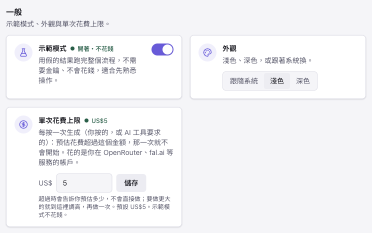
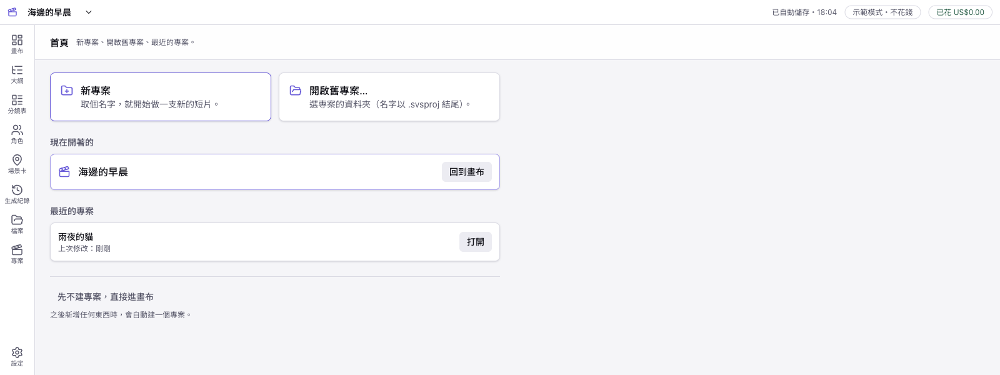
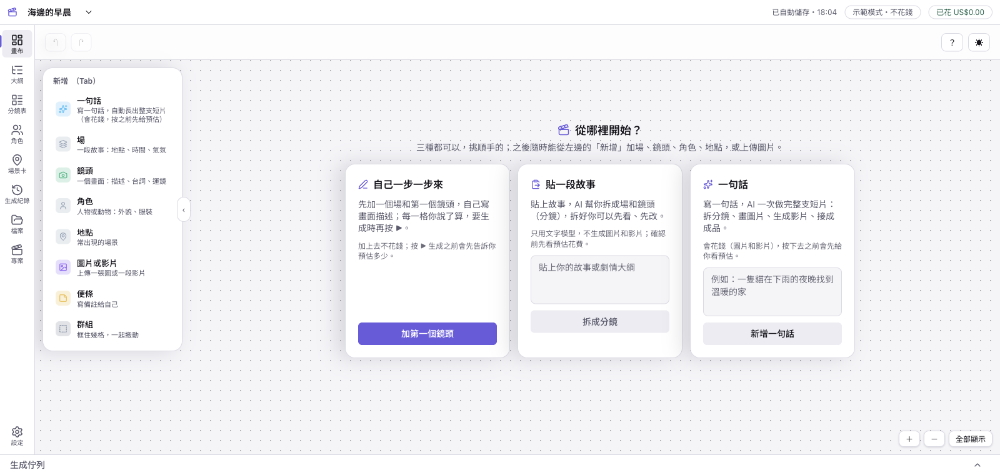
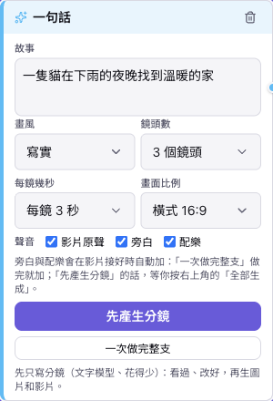
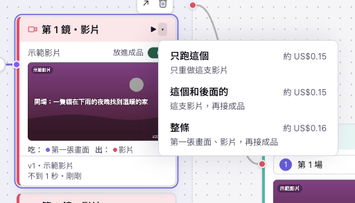

# Slima Video Studio

[English](README.md) · **繁體中文**

免費、開源的桌面工作台，把故事做成 AI 影片。你寫一句話或貼上劇本，App 會把它拆成場和鏡頭、為每個鏡頭生成第一張畫面和影片片段，配上旁白與配樂，再接成一支完整的短片。一切都在可編輯的節點畫布上，所以任何一個鏡頭有問題，只要重跑那一個。

它是**自帶金鑰（BYOK）**：App 沒有伺服器，也不提供模型。你連上自己的 AI 服務帳號（一把 [OpenRouter](https://openrouter.ai) 金鑰就能跑文字、圖片和影片），每次生成前都會先看到預估花費。

> **現況：早期版本（v0.x）。** 在 macOS（Apple Silicon）上可以從頭走到尾。Windows 版有打包，但還沒在真的 Windows 電腦上實測，也還沒提供下載。安裝檔還沒有程式碼簽章（見[第一次開啟](#第一次開啟)）。介面目前只有繁體中文。

## 你可以做什麼

- **一張畫布，從故事到成品。** 空白畫布有三種開始方式：自己一個鏡頭一個鏡頭加、貼一段故事讓 AI 拆成分鏡，或寫一句話（選畫風、鏡頭數、每鏡幾秒）。一句話可以先按「先產生分鏡」，只寫分鏡、看過改好再生成，也可以按「一次做完整支」一次做完。畫布會長出場、鏡頭、第一張畫面、影片片段和剪輯。
- **只修一個鏡頭，不重做整支片。** 改了鏡頭描述或角色，只有受影響的圖和影片節點會標「需要重跑」；每個鏡頭都保留各個版本。格子上的 ▶ 旁有個小箭頭，可以選「只跑這個」、「這個和後面的」或「整條」，每一種都先列出會做哪幾步、預估多少錢。
- **角色與地點。** 角色卡有鎖定的外觀描述、概念圖和三視圖，同一個角色可以在不同鏡頭重複使用。
- **先看花費。** 每次生成都會顯示預估並請你確認；「單次花費上限」（預設 US$5）保護你不會超支。
- **聲音。** 旁白（把鏡頭的台詞用 AI 聲音念出來）、一首配樂和影片模型自己的聲音會混進成品；成品面板可以把影片原聲調成關／小／中／大、配樂調成小／中／大，並用時間軸看什麼時候有什麼聲音。一句話卡片上有「影片原聲」「旁白」「配樂」三個勾選：先產生分鏡之後按右上角的「生成空的」，會在接好片之後照「旁白」「配樂」的勾選自動加上，確認視窗會列出這一行、花費也算進預估（自己一步一步做的專案不會自動加，到成品面板的「聲音」區加）。混音在本機、不花錢；旁白與配樂要花一點錢，會先顯示預估。
- **預覽與匯出。** 在 App 裡播放接好的成品；在畫布的「剪輯」節點按「匯出 MP4」（點開那一格，右邊的成品面板也有）就會直接匯出，不問存哪裡：檔案放在專案資料夾裡的「匯出」資料夾（磁碟上叫 `exports`），提示上的「打開資料夾」或專案選單 ▾ › 「在資料夾中顯示」都找得到；同一秒匯出兩次，檔名會加 -2、-3，不會互相蓋掉。預設會在片尾加 3 秒的字卡，列出用了哪些 AI 服務（在成品面板取消勾選「片尾加上 AI 服務標註（建議）」就不加；專案裡的成品不會被改）。接片與混音用內建的 FFmpeg，除了你設定的 AI 服務之外，不會有資料離開你的電腦。
- **讓 AI 助理幫你操作。** Claude Code、Claude Desktop 可以透過 App 內建的 MCP 伺服器做完整支片（見[連接 Claude](#連接-claude讓-ai-幫你操作)）。
- **畫布之外也有表格。** 左邊的導覽有：畫布、大綱、分鏡表、角色、場景卡（地點）、生成紀錄、檔案，以及「專案」（這個專案的資料夾與全部專案）和「設定」。其中大綱、分鏡表、角色、場景卡、生成紀錄、檔案都是同一份資料的不同檢視，復原與重做可以跨過去。
- **選用：** 從 [Slima](https://slima.ai) 匯入故事（唯讀，透過官方的 `slima-mcp`）。

## 開始使用

### 下載

安裝檔放在這個 repo 的 **Releases** 頁面：macOS（Apple Silicon）的 `.dmg`。Windows 安裝程式要等它內建的 FFmpeg 改成從原始碼編譯（見下方）之後才提供。每個版本都會列出各檔案的 SHA-256 雜湊。

### 第一次開啟

安裝檔還沒有 Apple Developer ID 或 Windows 程式碼簽章憑證，所以第一次開啟時系統會警告：

- **macOS：** 打開「系統設定 → 隱私權與安全性」，往下捲到「Slima Video Studio 已被阻擋」的訊息，按「仍要打開」並輸入密碼。如果 macOS 說 App「已損毀」，在終端機執行 `xattr -dr com.apple.quarantine "/Applications/Slima Video Studio.app"` 再開一次。
- **Windows：** 在 SmartScreen 視窗按「其他資訊 → 仍要執行」。
- 目前**沒有自動更新**；新版本請到 Releases 下載。

### 介面語言

App 有**繁體中文**與 **English** 兩種介面。第一次開啟會跟著系統語言（系統是中文就用繁體中文，其他語言用英文）；隨時可以在 **設定 → 一般 → 語言** 改。

**送給 AI 模型的提示詞不會翻譯。** 它們是模型要讀的固定文字（生成的圖片與影片也靠它），所以不跟著介面語言變；其中少數會顯示在畫面上（生成佇列、生成紀錄），在英文介面也還是中文。你自己寫的內容（故事、鏡頭描述）照你寫的語言送出；預設的分鏡準則跟著介面語言，改過的則照你改的。

### 不用金鑰先試玩

第一次啟動時選「**先試玩看看**」。App 會改用假的供應商：不需要金鑰、不連網，就能免費走完整個流程。

選好之後會進**首頁**：按「**新專案**」、取個名字就開始（也可以按「先不建專案，直接進畫布」，之後在畫布上新增任何東西時會自動建一個專案）。


### 用真的 AI

1. 建立 [OpenRouter](https://openrouter.ai) 帳號、儲值幾美元，建立一把 API 金鑰（可以在金鑰上設花費上限）。帳號要有餘額才能用付費的圖片和影片模型。
2. 在 App 的設定精靈，或「**設定 → 服務金鑰**」裡你那一家服務的卡片，貼上金鑰並按「**儲存**」。金鑰由作業系統加密保存在你的電腦上，之後畫面不會再完整顯示。在 macOS 上，系統可能會請你輸入登入密碼，讓 App 使用鑰匙圈；因為安裝檔還沒有 Developer ID 簽章，更新 App 之後可能會再問一次。
3. 在空畫布選一種開始方式（見下面的[在畫布上做一支片](#在畫布上做一支片)）。最省的走法：在「一句話」卡寫好故事、設好鏡頭數和秒數，按「**先產生分鏡**」（只寫分鏡、花得很少），看過、改好分鏡，再按右上角的「**生成空的（N 步，約 US$…）**」（只補還沒有結果的步驟；旁邊的 ▾ 另有「重跑標了需要重跑的」「全部重新生成」，各自寫著價錢），確認視窗列出會做的每一步與預估花費，按「執行」。想一次做完就按「一次做完整支」。

我們自己跑一支 2 鏡 × 3 秒的測試短片約花 US$1.1。預估有可能比實際價格低（我們那次預估 US$0.78），所以請從小的開始。「**單次花費上限**」（預設 US$5）是「**設定 → 一般**」裡同名的那張卡：一個美金欄位加「儲存」鈕。不管是你自己按的，還是 AI 助理要求的，每一次生成都受它管：預估超過上限，那一次就不會開始，App 會告訴你預估多少；要做更大的，就到那裡調高，再做一次。示範模式不花錢。AI 助理另外還有一個獨立的上限：「**AI 工具的總額度**」，見[連接 Claude](#連接-claude讓-ai-幫你操作)。



設定頁最上面有一排小標籤，按了就跳到那一區：「**一般**」「**AI 工具連線**」「**服務金鑰**」「**模型**」「**實驗功能**」（還在試的功能，可能隨時改變）。

### 專案與存檔



- **每個專案是磁碟上的一個資料夾**（名字以 `.svsproj` 結尾），圖片、影片和匯出的檔案都在裡面。
- **自動儲存。** 你做的每一步都會立刻存下來，上方一直寫著「已自動儲存・時間」，沒有儲存鈕；按 ⌘S 只會告訴你最後一次存在幾點。
- **開新的、開舊的。** 首頁（開 App 就看到，之後從專案名旁邊的 ▾ 選單 › 「首頁」回去）有「新專案」、「開啟舊專案…」和「最近的專案」。專案名旁邊的 ▾ 選單還有：全部專案、**另存為…**（⇧⌘S：連同圖片和影片複製成另一份，之後做的存在新的這一份，原本的留在原處）、改名、在資料夾中顯示。
- **macOS 上方的「檔案」選單**有同一批：新專案…（⌘N）、開啟舊專案…（⌘O）、開啟最近的專案、儲存（⌘S）、另存為…、改名…、在 Finder 顯示、首頁。

### 在畫布上做一支片



空白畫布有三張卡，挑順手的（都只是起點，之後隨時能從左邊的「新增」加場、鏡頭、角色、地點，或用「圖片或影片」上傳素材）：

- **自己一步一步來：** 加一個場和第一個鏡頭，自己在卡片上雙擊寫畫面描述，要生成時再按 ▶。
- **貼一段故事：** 貼上故事，AI 幫你拆成場和鏡頭（分鏡）；這一步不生成圖片和影片。
- **一句話：** 寫一句話、選畫風、鏡頭數和每鏡幾秒。主按鈕「先產生分鏡」只寫分鏡（只用文字模型、花得很少），你可以先看、先改；之後按右上角的「**生成空的**」，會先列出每一步和準確的預估，確認後才生成。想一次做完就按「**一次做完整支**」。



每個要花錢的動作都先給預估；示範模式不花錢。格子上的 **▶** 旁邊有個小箭頭，可以選：



- **只跑這個**：只重做這一格（做過的會多一個版本，舊的留著）；
- **這個和後面的**：這一格和它後面的步驟，最後接成成品；
- **整條**（影片節點才有）：這一鏡的第一張畫面、影片，再接成成品。

確認視窗會逐步列出這次會做什麼。如果其他鏡頭還沒有影片、接不成成品，視窗會直接寫「這次不會接成成品」，不會假裝會接；還不能跑的（例如影片還沒有第一張畫面）選項會灰掉並寫原因。

**刪除與復原。** 除了「剪輯」（它是場自動長出來的，把所有場刪掉它就消失）之外，每種節點都能刪：卡片上的垃圾桶、Delete 鍵或右鍵。刪除不會跳確認框，而是用提示寫清楚刪了什麼（例如刪一個鏡頭，會連同它的圖和影片版本），底下有「復原」，按它或 ⌘Z（Windows：Ctrl+Z）就全部找回來。不能刪的按鈕會停用並寫出原因。畫面右上角的「？」→「怎麼開始」有三步驟的簡短說明。

## 連接 Claude（讓 AI 幫你操作）

除了自己動手點，你也可以讓 **Claude Code**、**Claude Desktop** 這類 AI 助理幫你做片。App 內建一個本機的小伺服器，說的是 [MCP](https://modelcontextprotocol.io) 協定：助理可以建專案、把故事拆成場景與鏡頭、生成並「看」首幀圖、生成影片、重做某一鏡、替影片配旁白與配樂並混音與量測、接片並匯出 MP4，而且就在你畫面上同一個專案裡做，示範模式或用你自己的金鑰都可以。除了 App 之外不用另外安裝任何東西，連線也不會離開你的電腦（只連 `127.0.0.1`）。


_App 真實的設定頁，總開關已打開。最上面的圖看得出誰連上了：實線是已經連上，虛線是還沒連上。手動連線那一行（含 token）收在 Claude Code 那張卡的「更多」裡，token 預設遮蔽，按「顯示 token」才會看到。_

**一鍵連接**（需要 v0.3.0 以上；App 要開著）：

1. 打開 App →「**設定**」，在最上面那排小標籤選「**AI 工具連線**」。
2. 在「**Claude Code**」卡或「**Claude Desktop**」卡按「**連接**」（連好之後按鈕會變成「重新連接」，名字旁邊的燈從「還沒連接」變成「已設定」；App 在這台電腦上找不到 Claude 時，燈會寫「沒偵測到」）。這同時會打開總開關「**允許 AI 工具連線**」。Claude Desktop 要完全關掉（⌘Q）再重新打開；App 改它的設定檔之前會先備份，只加一項、不動你其他的伺服器。
3. 跟助理說，例如：「用 slima-video-studio 的工具。先呼叫 get_capabilities，讀 getting-started 指南，然後用這個故事做一支 3 鏡的短片：……」

在 **Claude Code** 裡輸入 `/mcp` 可以確認 `slima-video-studio` 已連上（新加的伺服器要開一個**新的** Claude Code 對話才會出現工具）。

### 用指令連接 Claude Code

這和 App 裡 **Claude Code** 卡上的「連接」按鈕做的是同一件事（macOS，App 裝在 `/Applications`）：用 App 自己的執行環境當小轉接，不用安裝任何東西，也不用複製 token。

```bash
claude mcp add --scope user slima-video-studio -e ELECTRON_RUN_AS_NODE=1 -- \
  "/Applications/Slima Video Studio.app/Contents/MacOS/Slima Video Studio" \
  "/Applications/Slima Video Studio.app/Contents/Resources/app.asar/out/main/mcp-stdio-bridge.js" \
  --user-data "$HOME/Library/Application Support/@svs/desktop"
```

加進去之後還有兩件事：在 App 的「設定 → AI 工具連線」打開「**允許 AI 工具連線**」（這行指令不會幫你打開，「連接」按鈕才會），然後開一個**新的** Claude Code 對話，因為對話中途加進去的伺服器要到下一個對話才會載入。

**該用哪一種連法？** 有兩種，都安全：

- **「連接」按鈕和上面的指令用的是一個小轉接**：它跟著你的助理一起啟動，每次都從 App 自己的資料夾讀目前的埠與 token，不用複製任何東西，按了「換一組新的 token」也不會失效。預設用這種；Claude Desktop 只會啟動指令，也只能用這種。
- **手動的 `claude mcp add --transport http …` 那一行（Claude Code 卡 →「更多」→「手動連線」，總開關打開之後才會出現）是直接連 App**，裡面寫著埠與秘密 token，所以換 token 或換埠就失效。只有你的 MCP 工具不能啟動指令、但可以送 HTTP 標頭時才用它。

**如果 Claude 說連線失敗、工具載不進來：** 先確認 App 有開著，而且「**設定 → AI 工具連線 → 允許 AI 工具連線**」是打開的，再在 Claude Desktop 或 Claude Code 開一個新對話。App 沒開的時候，助理那邊只看得到「連線失敗」；白話的說明要在 App 開著之後才會出現。

**助理能做什麼**（共 52 個工具；它用 `load_guide` 讀指南，也看得到每個工具的說明）：

| 範圍       | 工具                                                                                                                                                                                                                                                            |
| ---------- | --------------------------------------------------------------------------------------------------------------------------------------------------------------------------------------------------------------------------------------------------------------- |
| 開始       | `get_capabilities`、`load_guide`、`estimate_cost`                                                                                                                                                                                                               |
| 專案與模型 | `list_projects`、`get_current_project`、`open_project`、`create_project`、`configure_project`、`list_models`、`set_models`、`undo`、`redo`                                                                                                                      |
| 故事       | `split_story_into_scenes`、`get_outline`、`edit_outline`、`split_scene_into_shots`                                                                                                                                                                              |
| 鏡頭       | `list_shots`、`get_shot`、`update_shot`、`create_shot`、`delete_shots`、`reorder_shots`                                                                                                                                                                         |
| 角色       | `list_characters`、`create_character`、`update_character`、`suggest_character_anchor`、`set_character_anchor`、`list_project_images`、`add_character_reference`、`generate_character_images`、`view_character_images`、`pick_character_image`、`lock_character` |
| 圖片與影片 | `generate_first_frames`、`view_first_frames`、`generate_videos`、`view_video_stills`、`regenerate_shot`、`adopt_version`、`cancel_generation`、`wait_for_generation`、`get_generation_status`                                                                   |
| 成品       | `assemble_film`、`export_film`（有 `credits`：片尾字卡，預設開）                                                                                                                                                                                                |
| 聲音       | `get_sound`、`plan_sound`、`generate_narration`、`generate_music`、`adjust_sound_clip`、`adopt_sound_clip`、`remove_sound_clip`、`set_sound_settings`、`mix_sound`、`analyze_sound`                                                                             |

會看圖的工具回傳真的（縮小過的）圖片，所以助理可以在你花更多錢之前，先檢查第一張畫面與影片截圖有沒有出錯。

**你的保護**

- **預設關閉**，只在 `127.0.0.1`，每個請求都要帶秘密 token；「換一組新的 token」會讓舊的立刻失效。
- 助理看不到、也改不了你的服務金鑰、設定，以及下面兩個花費上限。
- **「AI 工具的總額度」預設是 US$0。** 就是同一區裡同名的那張卡（美金欄位；調高之前，它的燈寫「還不能花錢」）。示範模式不花錢；用真的 AI 時，每個要花錢的步驟（文字、圖片、影片）都會先用預估金額檢查並從總額度預留，會超過就拒絕；只有你能調高。卡片的「更多」裡有「已用的歸零」，歸零後可以再花同樣的額度。
- **助理要求的每一次生成，也受「單次花費上限」管**（設定 → 一般，預設 US$5），跟你自己按的是同一個上限。
- 助理開啟或建立專案，會切換 App 視窗裡顯示的專案。

**聲音（旁白、配樂、混音）。** 助理也能幫影片配上聲音：替每一鏡寫台詞、要旁白和一首配樂、調整時間與音量、把全部混進影片，並且**量測**結果（響度、峰值、安靜的段落、某一鏡完全沒聲音），因為它聽不到。旁白與配樂跟其他生成步驟一樣會花錢：先預估、受「AI 工具的總額度」限制，也可以替單一步驟設最高價格。成品好不好聽由你在 App 裡聽，同樣的控制項你也可以手動調：


_App 成品面板真實的聲音區（只有介面）。這裡旁白那一列是空的，因為這些鏡頭還沒有台詞；在鏡頭裡寫一句台詞，它就會被念出來。_

**連上之後**，Claude 會先讀 App 提供的入門指南（把場景拆成鏡頭前讀分鏡準則、花錢之前讀花費說明、配旁白與配樂之前讀聲音說明），也會先看過生成的首幀圖，再生成影片。工具的錯誤訊息是白話寫的，通常會說下一步怎麼做。連線 token 不需要任何人去找或複製。

## 模型

只填一把 OpenRouter 金鑰時的預設：

| 用途                       | 預設                                                                |
| -------------------------- | ------------------------------------------------------------------- |
| 拆鏡與描述                 | Claude Sonnet 5.5                                                   |
| 圖片（角色圖、第一張畫面） | Gemini 3 Pro Image                                                  |
| 影片                       | Kling 3.0 Standard（Veo 3.1 Lite 當便宜的草稿模型）                 |
| 旁白（念每一鏡的台詞）     | MiniMax Speech 2.8 HD（備選：ElevenLabs Eleven v3；聲音在設定裡選） |
| 配樂（一首純音樂）         | Google Lyria 3 Pro                                                  |

GPT Image 2（標準與高畫質兩檔）可以透過 OpenRouter 當圖片模型。再填一把 [fal.ai](https://fal.ai) 金鑰會多出更多模型與角色鎖定影片。實測的價格、endpoint 和我們實際觀察到的結果在 [docs/models.md](docs/models.md)。

## 已知限制

- **示範模式的拆場是假的。** 示範模式拆故事時回的是現成的假資料（幾幕、好幾個同名的場景、摘要是空的），不是根據你的故事做出來的。示範模式是用來免費試一遍流程（按鈕、面板、匯出）；想知道故事真的會拆成什麼樣，要用真的 AI。
- 影片模型有時會替沒有嘴巴、手腳的角色加上嘴、手臂或腳（Kling 常見，Veo 比較少）。在提示詞裡把角色描述成靜止、簡單的形狀有幫助；成品一定要檢查。
- 還沒有音效（旁白、配樂和影片模型自己的聲音都有），也沒有字幕。旁白是每一鏡一句台詞；台詞比鏡頭長只會警告，不會自動縮短。
- 片尾的 AI 服務字卡是 App 自己畫的，只加在匯出的檔案上；做不出來時匯出仍然成功，只是沒有字卡，並且會告訴你。
- macOS 安裝檔還沒有 Developer ID 簽章，所以每次更新後 macOS 可能再問一次密碼（只有用真的 AI 時）；見[用真的 AI](#用真的-ai)。
- 預設的「寫實」畫風，對可愛的角色可能畫出偏暗或令人不安的畫面；請選適合你故事的畫風。
- 安裝檔：macOS Intel 版還沒打；Linux 沒測過。
- **還沒有 Windows 下載。** Windows 版有打包，但沒在真的 Windows 電腦上實測過，而且它內建的 FFmpeg 是別人編的、我們還沒有提供它靜態連結的函式庫的對應原始碼。等我們把那個 FFmpeg 改成從原始碼編譯（macOS 版已經是）之後才會提供。

## 從原始碼建置

```bash
pnpm install
pnpm dev                                                    # 執行 App
SVS_PROVIDER_MODE=mock SVS_DISABLE_ONBOARDING=1 pnpm dev    # 示範模式，不用金鑰、不花錢
pnpm lint && pnpm typecheck && pnpm test                    # 檢查
pnpm test:e2e                                               # Electron 端對端測試（示範模式）
tools/ffmpeg/build-macos.sh                                 # 只有 macOS：編出要放進安裝檔的 FFmpeg（打包前先跑）
pnpm --filter @svs/desktop dist                             # 打包安裝檔（未簽章）
```

在 macOS 上，打包時會檢查安裝檔裡有沒有 `tools/ffmpeg/build-macos.sh` 編出的 FFmpeg（輸出在 `apps/desktop/build/ffmpeg/`），沒有就會報錯停下來。`pnpm dev`、測試與示範模式都不需要它。

需要 Node 22 與 pnpm 10。這是一個 pnpm workspace：`apps/desktop`（Electron App、React 介面）把 `packages/` 裡的套件（`schema`、`db`、`engine`、`providers`、`media`、`workflows`、`slima`）組起來，這些套件只依賴 `@svs/schema`。macOS 的 FFmpeg 由 [`tools/ffmpeg/build-macos.sh`](tools/ffmpeg/README.md) 從原始碼編譯。參與貢獻請看 [CONTRIBUTING.md](CONTRIBUTING.md)。

## 授權

Apache License 2.0，見 [LICENSE](LICENSE) 與 [NOTICE](NOTICE)。「Slima」與「Slima Video Studio」的名稱、Logo，以及小饅頭（Little Bun／Mochi）美術**不在**這個授權裡。安裝檔內含 FFmpeg（GPL v2 或更新版，只開 libx264，當成獨立程式執行），它的授權全文與原始碼取得方式隨安裝檔附上；其他第三方授權在 [THIRD-PARTY-NOTICES.md](THIRD-PARTY-NOTICES.md)。AI 服務金鑰與產生的費用由你自己負責。軟體依現況提供，不附任何保證。
