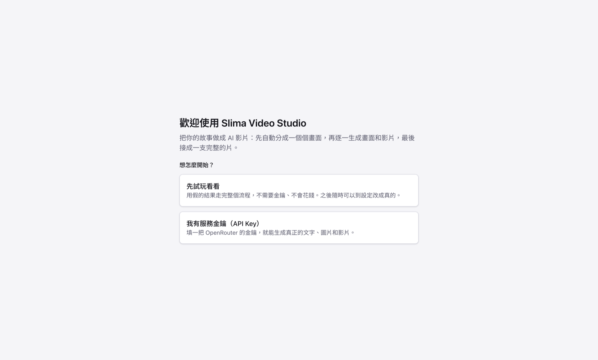
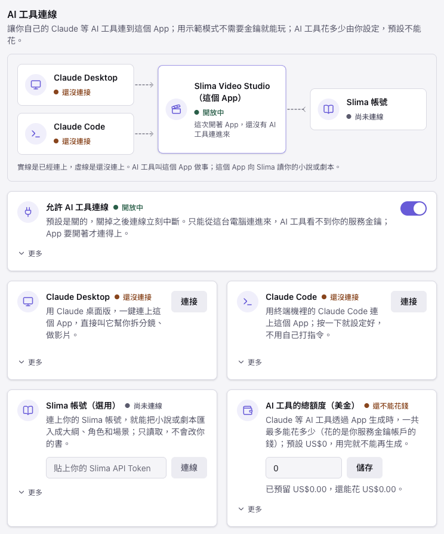

# Slima Video Studio

[English](README.md) · **繁體中文**

免費、開源的桌面工作台，把故事做成 AI 影片。你寫一句話或貼上劇本，App 會把它拆成場和鏡頭、為每個鏡頭生成第一張畫面和影片片段，再接成一支完整的短片。一切都在可編輯的節點畫布上，所以任何一個鏡頭有問題，只要重跑那一個。

它是**自帶金鑰（BYOK）**：App 沒有伺服器，也不提供模型。你連上自己的 AI 服務帳號（一把 [OpenRouter](https://openrouter.ai) 金鑰就能跑文字、圖片和影片），每次生成前都會先看到預估花費。

> **現況：早期版本（v0.x）。** 在 macOS（Apple Silicon）上可以從頭走到尾。Windows 版有打包，但還沒在真的 Windows 電腦上實測，也還沒提供下載。安裝檔還沒有程式碼簽章（見[第一次開啟](#第一次開啟)）。介面目前只有繁體中文。

## 你可以做什麼

- **一張畫布，從故事到成片。** 寫一句話，選畫風、鏡頭數、每鏡幾秒，畫布就長出整支短片：場、鏡頭、第一張畫面、影片片段和剪輯。
- **只修一個鏡頭，不重做整支片。** 改了鏡頭描述或角色，只有受影響的圖和影片會標「需要重跑」；每個鏡頭都保留各個版本。
- **角色與地點。** 角色卡有鎖定的外觀描述、概念圖和三視圖，同一個角色可以在不同鏡頭重複使用。
- **先看花費。** 每次生成都會顯示預估並請你確認；單次上限（預設 US$5）保護你不會超支。
- **預覽與匯出。** 在 App 裡播放接好的成品，匯出成 MP4。接片用內建的 FFmpeg，除了你設定的 AI 服務之外，不會有資料離開你的電腦。
- **畫布之外也有表格。** 大綱、分鏡表、角色、地點、生成紀錄、檔案都是同一份資料的不同檢視，復原與重做可以跨過去。
- **選用：** 從 [Slima](https://slima.ai) 匯入故事（唯讀，透過官方的 `slima-mcp`）。

## 開始使用

### 下載

安裝檔放在這個 repo 的 **Releases** 頁面：macOS（Apple Silicon）的 `.dmg`。Windows 安裝程式要等它內建的 FFmpeg 改成從原始碼編譯（見下方）之後才提供。每個版本都會列出各檔案的 SHA-256 雜湊。

### 第一次開啟

安裝檔還沒有 Apple Developer ID 或 Windows 程式碼簽章憑證，所以第一次開啟時系統會警告：

- **macOS：** 打開「系統設定 → 隱私權與安全性」，往下捲到「Slima Video Studio 已被阻擋」的訊息，按「仍要打開」並輸入密碼。如果 macOS 說 App「已損毀」，在終端機執行 `xattr -dr com.apple.quarantine "/Applications/Slima Video Studio.app"` 再開一次。
- **Windows：** 在 SmartScreen 視窗按「其他資訊 → 仍要執行」。
- 目前**沒有自動更新**；新版本請到 Releases 下載。

### 不用金鑰先試玩

第一次啟動時選**「先試玩看看」**。App 會改用假的供應商：不需要金鑰、不連網，就能免費走完整個流程。



### 用真的 AI

1. 建立 [OpenRouter](https://openrouter.ai) 帳號、儲值幾美元，建立一把 API 金鑰（可以在金鑰上設花費上限）。帳號要有餘額才能用付費的圖片和影片模型。
2. 在 App 的設定精靈（或「設定」）貼上金鑰。金鑰由作業系統加密保存在你的電腦上，之後畫面不會再完整顯示。
3. 在畫布上寫一句話，設定鏡頭數和秒數，按**生成**並確認預估花費。

我們自己跑一支 2 鏡 × 3 秒的測試短片約花 US$1.1。預估有可能比實際價格低（我們那次預估 US$0.78），所以請從小的開始。

## 連接 Claude（讓 AI 幫你操作）

除了自己動手點，你也可以讓 **Claude Code**、**Claude Desktop** 這類 AI 助理幫你做片。App 內建一個本機的小伺服器，說的是 [MCP](https://modelcontextprotocol.io) 協定：助理可以建專案、把故事拆成場景與鏡頭、生成並「看」首幀圖、生成影片、重做某一鏡、接片並匯出 MP4，而且就在你畫面上同一個專案裡做。除了 App 之外不用另外安裝任何東西，連線也不會離開你的電腦（只連 `127.0.0.1`）。



_App 真實的設定頁（token 預設遮蔽，按「顯示 token」才會看到）。_

**一鍵連接**（需要 v0.2.0 以上；App 要開著）：

1. 打開 App →「**設定**」→「**AI 工具連線（MCP）**」。
2. 按「**連接 Claude Code**」或「**連接 Claude Desktop**」。這同時會打開「允許 AI 工具連線」。Claude Desktop 要完全關掉（⌘Q）再重新打開；App 改它的設定檔之前會先備份，只加一項、不動你其他的伺服器。
3. 跟助理說，例如：「用 slima-video-studio 的工具。先呼叫 get_capabilities，讀 getting-started 指南，然後用這個故事做一支 3 鏡的短片：……」

在 **Claude Code** 裡輸入 `/mcp` 可以確認 `slima-video-studio` 已連上（新加的伺服器要開一個**新的** Claude Code 對話才會出現工具）。想自己貼指令的話，設定頁也有手動的 `claude mcp add …` 那一行。

**用指令連接（macOS，App 裝在 `/Applications`）**：做的事跟按鈕一樣，用 App 自己的執行環境當小轉接，不用安裝任何東西，也不用複製 token：

```bash
claude mcp add --scope user slima-video-studio -e ELECTRON_RUN_AS_NODE=1 -- \
  "/Applications/Slima Video Studio.app/Contents/MacOS/Slima Video Studio" \
  "/Applications/Slima Video Studio.app/Contents/Resources/app.asar/out/main/mcp-stdio-bridge.js" \
  --user-data "$HOME/Library/Application Support/@svs/desktop"
```

你還是要在「設定」裡勾一次「**允許 AI 工具連線**」（一鍵連接的按鈕會幫你勾）。

**你的保護**

- **預設關閉**，只在 `127.0.0.1`，每個請求都要帶秘密 token；「換一組新的 token」會讓舊的立刻失效。
- 助理看不到、也改不了你的服務金鑰、設定與花費額度。
- **AI 工具的花費額度預設是 US$0。** 示範模式不花錢；用真的 AI 時，每個要花錢的步驟（文字、圖片、影片）都會先用預估金額檢查，超過額度就拒絕；只有你能在同一個設定頁調高額度。
- 助理開啟或建立專案，會切換 App 視窗裡顯示的專案。

**聲音（旁白、配樂、混音）。** 助理也能幫影片配上聲音：替每一鏡寫台詞、要旁白和一首配樂、調整時間與音量、把全部混進影片，並且**量測**結果（響度、峰值、安靜的段落、某一鏡完全沒聲音），因為它聽不到。旁白與配樂跟其他生成步驟一樣會花錢：先預估、受花費額度限制，也可以替單一步驟設最高價格。成品好不好聽由你在 App 裡聽，同樣的控制項你也可以手動調：


_App 成品面板真實的聲音區（只有介面）。_

**給正在讀這一頁的 AI 助理：** 這是一個桌面程式，只有使用者能把它的連線打開。如果你能在使用者的 Mac 上執行指令，就自己執行上面的 `claude mcp add …`（只想用在某個資料夾就加 `--scope project`），然後請使用者 (1) 打開 App，在「設定 → AI 工具連線」勾「允許 AI 工具連線」，(2) 開一個新的 Claude Code 對話，因為對話中途加進去的伺服器要到新對話才會載入。不能執行指令的話，就請使用者按一鍵連接的按鈕。不管哪種，你都不需要找或處理連線 token。連上之後先呼叫 `get_capabilities`，再用 `load_guide` 讀 `getting-started`（把場景拆成鏡頭前讀 `storyboard`，花錢之前讀 `spending`，配旁白與配樂之前讀 `sound`）。先生成首幀圖並用 `view_first_frames` 看過，再生成影片。工具的錯誤訊息是白話寫的，通常會說下一步怎麼做。

## 模型

只填一把 OpenRouter 金鑰時的預設：

| 用途                       | 預設                                                |
| -------------------------- | --------------------------------------------------- |
| 拆鏡與描述                 | Claude Sonnet 5.5                                   |
| 圖片（角色圖、第一張畫面） | Gemini 3 Pro Image                                  |
| 影片                       | Kling 3.0 Standard（Veo 3.1 Lite 當便宜的草稿模型） |

再填一把 [fal.ai](https://fal.ai) 金鑰會多出更多模型與角色鎖定影片。實測的價格、endpoint 和我們實際觀察到的結果在 [docs/models.md](docs/models.md)。

## 已知限制

- 影片模型有時會替沒有嘴巴、手腳的角色加上嘴、手臂或腳（Kling 常見，Veo 比較少）。在提示詞裡把角色描述成靜止、簡單的形狀有幫助；成品一定要檢查。
- 還不支援 OpenAI 的圖片模型（`gpt-image-2`）：它們要走 OpenRouter 的另一個端點，不是 App 現在用的那個。
- 還沒有聲音（配音、配樂、音效），也沒有字幕。
- 預設的「寫實」畫風，對可愛的角色可能畫出偏暗或令人不安的畫面；請選適合你故事的畫風。
- 安裝檔：macOS Intel 版還沒打；Linux 沒測過。
- **還沒有 Windows 下載。** Windows 版有打包，但沒在真的 Windows 電腦上實測過，而且它內建的 FFmpeg 是別人編的、我們還沒有提供它靜態連結的函式庫的對應原始碼。等我們把那個 FFmpeg 改成從原始碼編譯（macOS 版已經是）之後才會提供。

## 從原始碼建置

```bash
pnpm install
pnpm dev                                                    # 執行 App
SVS_PROVIDER_MODE=mock SVS_DISABLE_ONBOARDING=1 pnpm dev    # 示範模式，不用金鑰、不花錢
pnpm lint && pnpm typecheck && pnpm test                    # 檢查
pnpm test:e2e                                               # Electron 端對端測試（示範模式）
tools/ffmpeg/build-macos.sh                                 # 只有 macOS：編出要放進安裝檔的 FFmpeg（打包前先跑）
pnpm --filter @svs/desktop dist                             # 打包安裝檔（未簽章）
```

在 macOS 上，打包時會檢查安裝檔裡有沒有 `tools/ffmpeg/build-macos.sh` 編出的 FFmpeg（輸出在 `apps/desktop/build/ffmpeg/`），沒有就會報錯停下來。`pnpm dev`、測試與示範模式都不需要它。

需要 Node 22 與 pnpm 10。這是一個 pnpm workspace：`apps/desktop`（Electron App、React 介面）把 `packages/` 裡的套件（`schema`、`db`、`engine`、`providers`、`media`、`workflows`、`slima`）組起來，這些套件只依賴 `@svs/schema`。macOS 的 FFmpeg 由 [`tools/ffmpeg/build-macos.sh`](tools/ffmpeg/README.md) 從原始碼編譯。參與貢獻請看 [CONTRIBUTING.md](CONTRIBUTING.md)。

## 授權

Apache License 2.0，見 [LICENSE](LICENSE) 與 [NOTICE](NOTICE)。「Slima」與「Slima Video Studio」的名稱、Logo，以及小饅頭（Little Bun／Mochi）美術**不在**這個授權裡。安裝檔內含 FFmpeg（GPL v2 或更新版，只開 libx264，當成獨立程式執行），它的授權全文與原始碼取得方式隨安裝檔附上；其他第三方授權在 [THIRD-PARTY-NOTICES.md](THIRD-PARTY-NOTICES.md)。AI 服務金鑰與產生的費用由你自己負責。軟體依現況提供，不附任何保證。
